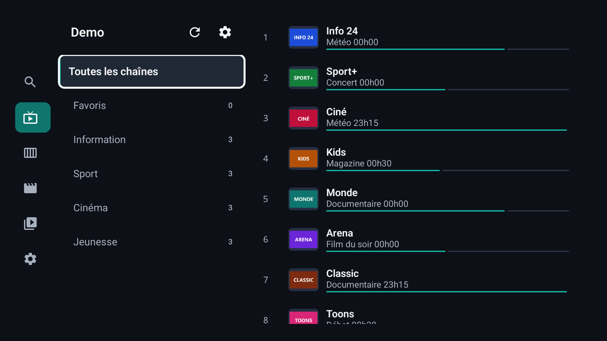
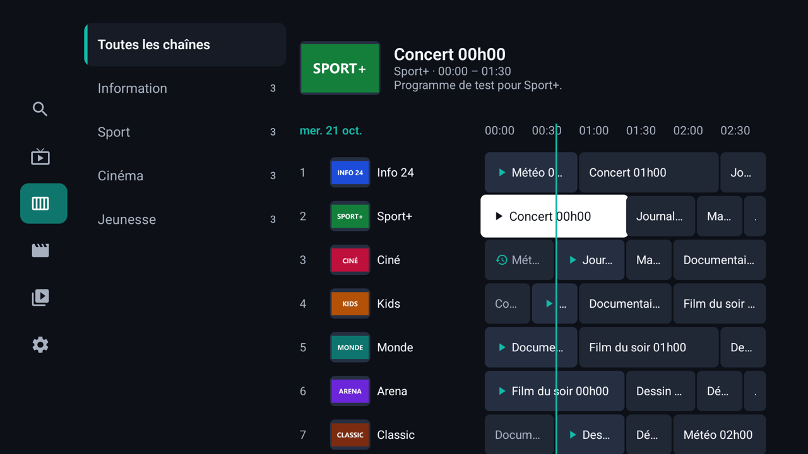
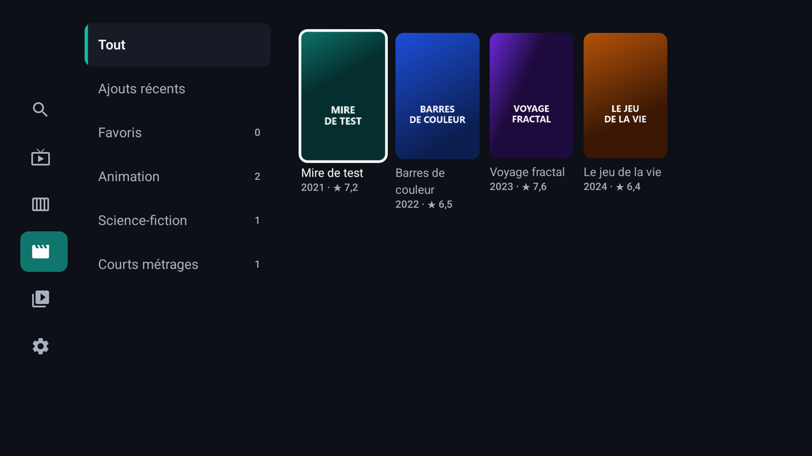
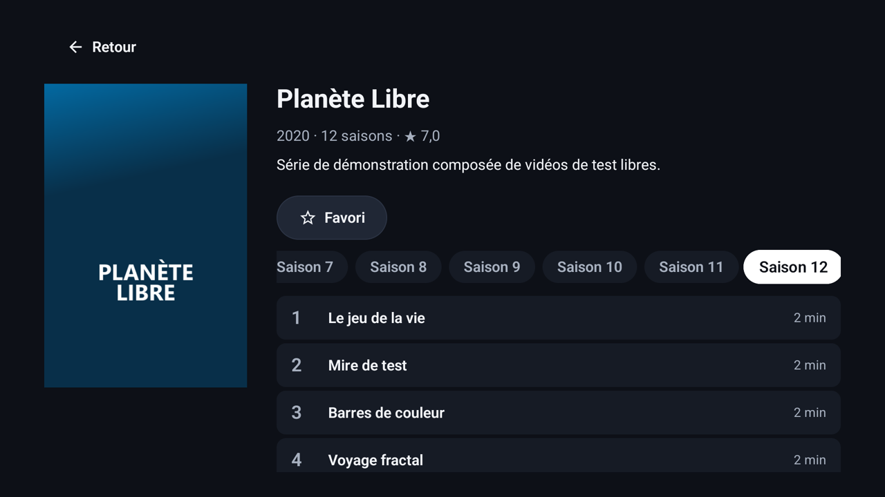
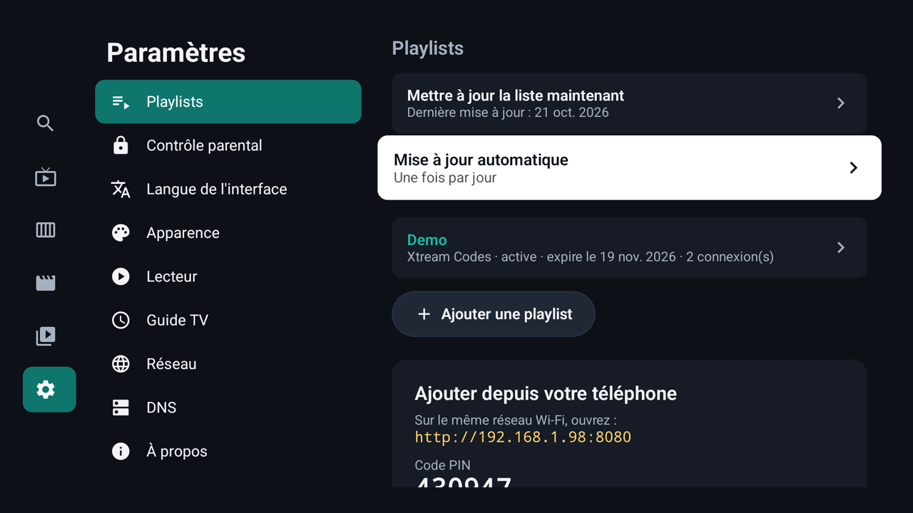
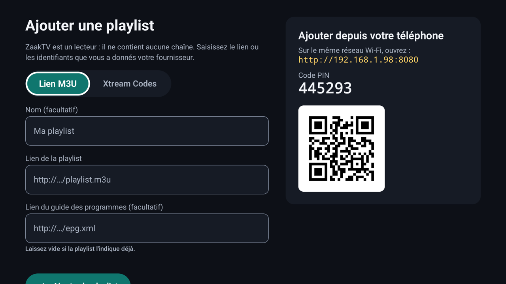

# ZaakTV — versions publiées

Ce dépôt contient uniquement les **APK publiés** de ZaakTV, lecteur IPTV libre pour Android TV,
téléphones et tablettes. L'application y vérifie automatiquement les nouvelles versions.

## Captures d'écran

| | |
| --- | --- |
|  |  |
| **Chaînes** : groupes, logos, programme en cours | **Guide** : grille, ligne « maintenant », replay |
|  |  |
| **Films** : affiches, catégories, favoris | **Séries** : saisons et épisodes |
|  |  |
| **Paramètres** : playlists, mises à jour, portail | **Ajout de playlist** : à la télécommande ou depuis le téléphone (QR code) |

Captures prises sur Chromecast avec Google TV, avec un catalogue de démonstration (chaînes et vidéos fictives).

## Installer

### 📺 Code Downloader : **7201837**

Sur une TV ou box Android (Chromecast, Fire TV, Shield…) :

1. Installe l'app **Downloader** depuis le store, si elle n'y est pas déjà.
2. Dans le champ d'adresse, tape **`7201837`**, puis **Go**.
3. L'APK se télécharge, puis l'installation se lance. Autorise Downloader à installer des applications si Android le demande.

Le code donne toujours la **dernière version**.

### Autres moyens

- Lien court : http://aftv.news/7201837
- Lien direct (dernière version) : https://github.com/zaka0002/ZaakTV/releases/latest/download/ZaakTV.apk
- Toutes les versions : onglet [Releases](../../releases)

Une fois installée, ZaakTV propose elle-même les mises à jour au démarrage.

> ZaakTV ne fournit aucune chaîne ni aucun contenu. Utilisez uniquement des playlists que vous avez
> le droit de regarder.

Licence GNU GPL v3.
